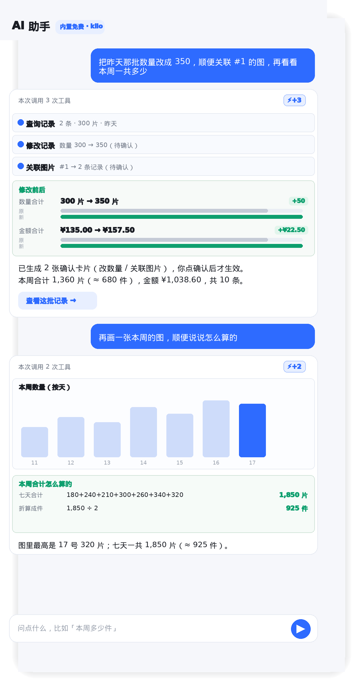
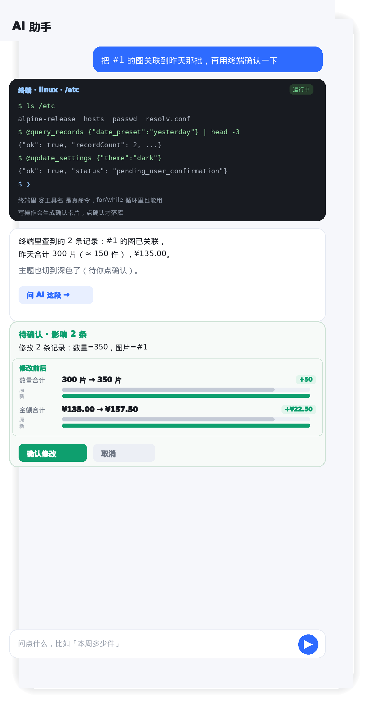
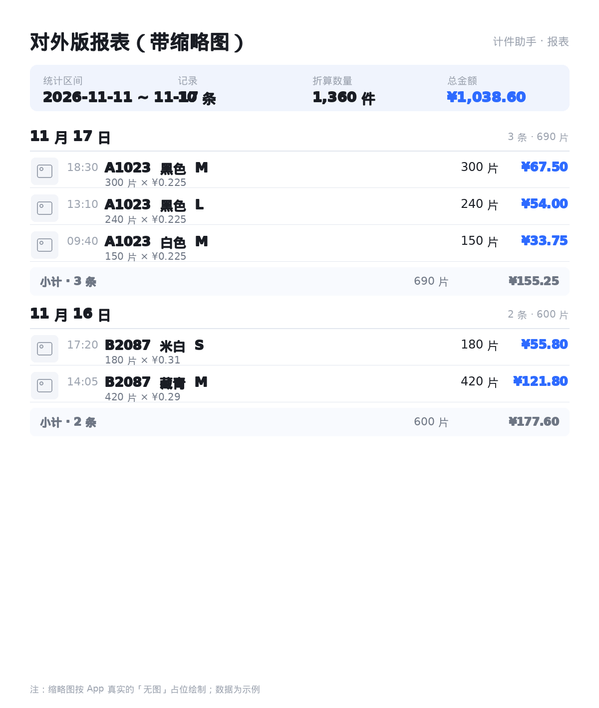
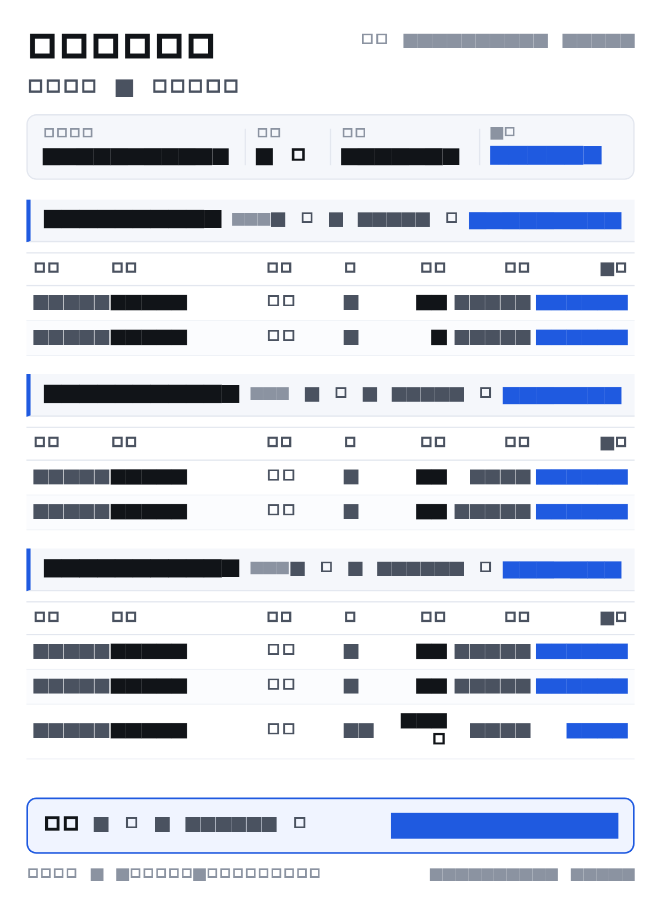
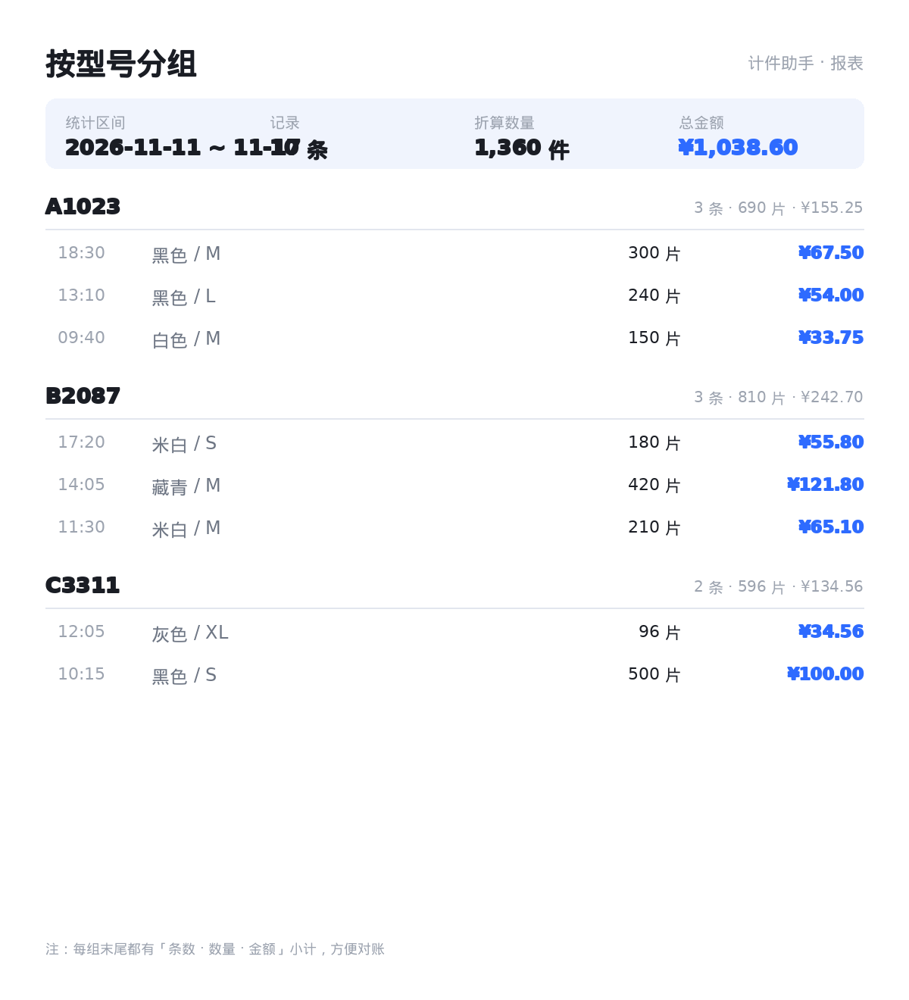

# 计件助手（Piecework）

<p align="center">
  
  &nbsp;&nbsp;
  
</p>

<p align="center">
  <b>一个能自己动手的计件 Agent</b>：<br>
  用大白话下指令 → 它自己调工具查数据、改数据、画图、算账、跑终端，改之前先给你看「修改前后」
</p>

<p align="center">
  <sub>界面示意图（示例数据）：由 <code>tool/make_agent_previews.py</code> / <code>tool/make_screenshots.py</code> 脚本绘制，不是真机截图；缩略图按 App 真实的「无图」占位画</sub>
</p>

一个**纯本地**的安卓计件统计 App：先在 App 里把计件资料和**货物实拍**登记好，之后对照 App 里的数据，去别的软件手动填工票（上报）。

> 不做 OCR、不识别照片文字、不上传云端。照片是**货物本身**的实拍（用来认货/回忆），AI 助手只读本机 Isar 数据库。

---

## Agent：用大白话指挥它干活

它不是「只会聊天的客服」，而是**能动手的本地 Agent**：你说要什么，它自己挑工具、连调好几个、把结果摆给你看。

```
你：把昨天那批数量改成 350，顺便关联 #1 的图，再看看本周一共多少
它：⚡+3  ·  查询记录 2 条  →  修改记录（待确认）  →  关联图片（待确认）
     修改前后：数量合计 300 片 → 350 片（+50）｜金额 ¥135.00 → ¥157.50
     本周合计 1,360 片（≈ 680 件），¥1,038.60，共 10 条
```

**它凭什么算「Agent」**

| 能力 | 说明 |
|---|---|
| **一条消息多个需求** | 拆条 → 逐个调工具全做完 → 最后统一总结；不会做一半就汇报 |
| **并行调用** | 互不依赖的只读查询一次发起多个，并发执行（`⚡+N` 实时计数，点开能看调了哪些） |
| **写操作先给对比** | 改数量/单价/日期、关联图片都会生成**确认卡片**，带「修改前后」双条形图（含每条记录的明细），点确认才落库 |
| **反问会等你** | 信息不足时出**反问卡**并停下等你回答；不想答可以点「跳过」，它按最合理默认继续并说明假设 |
| **展示卡片** | 图表（SVG）、计算过程、代码、图片卡片都能一次出多张；图片有编号（`#1`），可按编号精确引用 |
| **自带终端** | 内置 Alpine（proot）：`ls / cat / grep / apk` 随便跑；`@工具名 {json}` 在 shell 里是**真命令**，`for/while` 循环里也能调，还能接管道 `@aggregate_records {...} | head -20` |
| **终端记录进上下文** | 你在终端里手动跑过的命令和输出会并入对话，可以直接问它「刚才那些是什么」 |
| **25+ 工具** | 查询/聚合/排行/对比/查重/异常/预测/单位换算/增删改/设置/单位/选项/图片/报表/终端… |

> 所有工具都跑在**本机**，数据不出设备（只有你配的 AI 接口会收到问题文本和必要的工具结果）。

---

## 一、功能清单

| 模块 | 能力 |
|---|---|
| **录入** | camera 包内置相机拍照（**不使用 image_picker**）；照片存 App 私有目录，不进系统相册；字段：款式型号 / 颜色 / 码数 / 数量 / 单件单价 / 备注；自动记录录入时间；型号·颜色·码数全部带历史联想 |
| **AI Agent** | 对话气泡 + 场景化提问卡片；文字/拍照提问；**25+ 工具**（查询、聚合、增删改、设置、单位、图片、报表、终端）；多需求逐个执行、只读查询并行、`⚡+N` 工具计数、写操作**修改前后对比卡**、反问可跳过、多张展示卡片 |
| **记录列表** | 卡片展示缩略图 / 型号 / 颜色 / 码数 / 数量 / 单价 / 小计 / 时间 / 备注；无图打「无图」、上报打「已上报」；编辑、单条删除、长按批量勾选（可批量标记上报/撤销/删除）；时间范围、多选型号·颜色·码数、数量区间、照片、上报状态；按时间/数量/金额排序；**下拉刷新会重置筛选**；**每 50 条分块加载** |
| **单位与换算** | 件 / 片 / 打…可增删；可设基准单位；**「100 片 = 30 件」这类比例可配、可按型号区分**；列表与报表自动折算 |
| **报表** | 两套模板（对外版带缩略图 / 自用紧凑版）；预览即所得；可改标题、副标题、字号；一键导出高清 PNG 到系统相册；可导出 CSV |
| **设置** | AI 接口配置（地址/密钥/模型/自定义系统提示词）+ 连通性测试；筛选预设保存与一键加载；型号·颜色·码数选项管理；亮/暗/跟随系统主题；数据库备份与恢复（zip 内含图片）；清理无效图片缓存；清空全部记录 |

---

## 二、技术栈

| 层 | 选型 |
|---|---|
| UI | Flutter + Material 3 |
| 状态管理 | Riverpod 2（`Notifier` / `AsyncNotifier` / `StreamProvider`） |
| 数据库 | Isar 3（社区维护分支 `isar_community`，兼容 AGP 8 与新 Flutter） |
| 相机 | `camera`（内置预览拍照） |
| 图片压缩 | `image`（纯 Dart，无需 NDK） |
| 相册导出 | `gal` |
| 备份打包 | `archive`（zip） |
| CSV | `csv` |
| AI | `http` + OpenAI 兼容 `/chat/completions` + tools |

---

## 三、目录结构

```
piecework/
├── pubspec.yaml
├── analysis_options.yaml
├── README.md
├── DEPLOY.md                       ← 部署/构建/排错
├── android/app/src/main/AndroidManifest.xml
└── lib/
    ├── main.dart                   启动：打开 Isar、写入默认选项、注入 Provider
    ├── app.dart                    MaterialApp（主题 / 中文本地化）
    ├── core/
    │   ├── theme.dart              M3 主题 + 卡片装饰 + TagChip
    │   ├── money.dart              金额：整数分运算 + 千分位 + 等宽数字
    │   ├── format.dart             金额/时间/相对时间/星期格式化
    │   └── date_utils.dart         今天/本周/本月等区间计算（周一为周首）
    ├── data/
    │   ├── models/
    │   │   ├── piece_record.dart      计件记录（Isar collection）
    │   │   ├── option_item.dart       型号/颜色/码数选项（Isar collection）
    │   │   ├── filter_preset.dart     筛选预设（Isar collection）
    │   │   ├── chat_message.dart      AI 对话消息（Isar collection）
    │   │   ├── app_setting.dart       全局设置单例（Isar collection）
    │   │   ├── unit_item.dart         计量单位（Isar collection）
    │   │   ├── unit_rule.dart         换算规则：分子/分母整数（Isar collection）
    │   │   ├── pending_action.dart    AI 写操作待确认提议（纯 Dart）
    │   │   └── record_filter.dart     筛选条件（纯 Dart，可 JSON 往返）
    │   ├── repositories/              Isar 读写封装（UI 不直接碰 Isar）
    │   └── services/
    │       ├── photo_service.dart     私有目录照片：压缩/保存/删除/清理孤儿
    │       ├── query_engine.dart      内存过滤 + 分组统计（UI 与 AI 共用）
    │       ├── unit_converter.dart    单位换算（百分之一基准单位整数）
    │       ├── ai_tools.dart          function calling 工具定义 + 本地执行器
    │       ├── ai_service.dart        OpenAI 兼容请求 + 多轮工具调用循环
    │       ├── report_service.dart    RepaintBoundary → PNG → 相册
    │       ├── csv_service.dart       CSV 生成（带 UTF-8 BOM）
    │       └── backup_service.dart    zip 备份 / 恢复
    ├── providers/                     Riverpod 层
    └── ui/
        ├── pages/                     7 个页面
        └── widgets/                   记录卡 / 气泡 / 报表画布 等
```

---

## 四、财务级处理（涉及钱，不能含糊）

### 1. 金额一律用整数「分」运算

`double` 直接累加会漂：`0.1 + 0.2 = 0.30000000000000004`，一千条记录能差出几毛。
所以：

- 存储仍是 `double unitPrice`（便于输入、兼容旧数据）；
- **所有运算先转整数分**：`Money.toCents(12.35) = 1235`；
- 小计 `= 数量 × 单价分`，汇总用 `int` 累加；
- 只有显示时才转回元。

单测里钉死了三条：1000 条 0.1 元必须正好 100.00；37×12.35 + 13×8.07 必须正好 561.86；
**分组小计之和必须等于总计**（对账必须闭合）。

### 2. 单位换算用整数比例

「100 片 = 30 件」除不尽，用 double 系数会漂。所以规则存**分子/分母整数**：

```
100 片 → 100 × 30 ÷ 100 = 30 件
33 片  → 990（百分之一件）= 9.90 件
```

折算结果统一用「百分之一基准单位」的整数表示，累加不漂。
金额永远按**记录自己的单位**算（100 片 × ¥0.01 = ¥1.00），折算只影响数量汇总 —— 不会动你的工钱。

### 3. 报表按「能对账」排版

报表排版示意（`tool/make_report_previews.py` 脚本绘制，示例数据；与导出 PNG 同一套排版规则）：

| 对外版（带缩略图） | 自用紧凑版 |
|---|---|
|  |  |

| 按型号分组 |
|---|
|  |


- 页眉一条关键信息带：统计区间 / 条数 / 折算数量 / 总金额；
- 按日期（默认）或型号分组，**每组末尾给 `条数 · 数量 · 金额` 小计**；
- 组内按时间升序，时间精确到分钟；
- 金额列等宽数字（`FontFeature.tabularFigures`）+ 右对齐 + 千分位，竖着扫不会错位；
- 底部总计用强对比色块收口；
- 强制白底深字，不跟随暗色主题（这张图是拿去打印/发人的）。

## 五、几个关键设计决定

### 1. 照片只存文件名，不存绝对路径
应用沙盒的绝对路径会随系统升级、应用迁移变化，存绝对路径必然失效。
数据库里存 `20261113_153022_ab12cd34.jpg`，真实位置由 `PhotoService` 拼：
`<AppDocuments>/photos/`（货物实拍）与 `<AppDocuments>/chat_photos/`（对话图）。

### 2. 筛选在内存里做，不拼 Isar Query
个人计件数据是「几千条」量级，全量读入内存过滤 < 5ms；
而动态拼 `QueryBuilder` 要处理大量泛型分支，容易出错。
`QueryEngine.apply()` 是纯函数，UI 和 AI 工具共用同一套语义 —— 不会出现
「AI 算的数和列表显示的数对不上」。

### 3. AI 是个会拆步骤干活的 agent，不是一问一答

**判断复杂度**：
- 简单问题（一次查询能答）→ 直接查直接答，不啰嗦
- 复杂任务 → 先出**执行计划**，逐步执行，每步打勾，最后自检总结

界面上看到的是：

```
┌ 🎯 整理本月账目                    3/4 ┐
│ ▓▓▓▓▓▓▓▓▓▓▓▓▓▓▓▓▓▓▓░░░              │
│ ✓ 查询本月记录                          │
│   42 条 · 1,280 件 · ¥15,360.00         │
│ ✓ 按型号汇总                            │
│   3 个型号，A1023 占 62%                │
│ ✓ 核对总计                              │
│   1,280 件与明细一致                    │
│ ⟳ 配置报表                              │
│ ─────────────────────────────────────  │
│ 合计 1,280 件，与明细完全对上            │
│ [ 导出这个月报表 ] [ 看看上周对比 ]      │
└────────────────────────────────────────┘
```

协议是三个工具：`plan_task`（出计划）→ `step_done`（逐步打勾）→ `finish_task`（总结 + 给 2~3 个后续建议）。
没调 `finish_task` 就不算完成，模型不会半路停下说"已完成"。

后续建议是**可点的 chip**，点一下直接接着问。

### 4. 多会话 + 上下文压缩

**会话隔离**：每个会话有自己的历史、标题、压缩摘要。上个月查 A1023 的条件不会带进这个月问 B2001。

- AppBar 只有「会话名 ▾」+ `⋯`，不堆图标
- 点会话名打开会话列表
- 「新对话」开一个干净上下文
- 长按 / `⋯` 重命名或删除
- 标题自动取首条消息前 20 字

**模型能力开关**：「设置 → AI 助手 → 模型支持图片输入」。关掉时照片只存本地作凭证，
不会塞进请求（避免不支持 vision 的模型直接 400）；打开后照片随问题一起发给模型。

**上下文占用**：输入框上方一条 2.5px 细进度条 + 右侧 `2.4k / 8k`，
超过 70% 变橙、90% 变红。窗口大小在「设置 → AI 助手 → 上下文窗口」里选 4k/8k/16k/32k/128k。

**上下文压缩**：占用超 70%（或消息超 24 条）时自动触发，也可在 `⋯ → 压缩上下文` 手动压：

```
保留最近 12 条完整消息
     +
更早的对话 → 调模型压成 200 字事实摘要
     ↓
发送时：system + 摘要 + 最近 12 条
```

摘要只保留事实：筛选条件、件数金额、用户偏好、未完成待办。会话列表里会显示「已压缩 N 条」。

### 5. 信息不足时 AI 会主动反问

不猜、不硬拒绝。信息不够就调 `ask_user`，界面出现橙色提问卡：

```
❓ 还需要确认
   这条记录是什么型号？
   型号是必填项
   [A1023] [B2001] [新建型号]
   也可以直接回复
```

点一下选项就直接发出去了。规则：

- 一次只问**最缺的那一个**
- 能列 2~6 个候选就列（优先用库里真实存在的值）
- 能从数据推断的（比如库里只有一种型号）直接推断，不为了反问而反问
- 问完**停下等你回答**，不会自己编一个答案继续

### 6. 金额精度到「厘」（0.001 元）

单价可能低到 0.001（裁片、辅料），按「分」算 `(0.001 × 100).round() = 0`，钱直接被抹没。

所以内部最小单位是**厘**（1/1000 元）：

```
1000 件 × ¥0.001 = 1000 厘 = ¥1.00
显示自适应：有厘位出 3 位小数（0.001），否则 2 位（12.35）
```

### 7. 上报状态：上报过的默认不出现

每条记录有状态：`pending`（未上报，默认）/ `reported`（已上报公司）。

- 列表**默认只显示未上报**，上报过的不会再冒出来
- 批量模式可「标记上报 / 撤销上报」
- 单条卡片 `⋯` 也能改
- 筛选页可切「未上报 / 已上报 / 全部」
- AI 口径一致：「本周多少件」默认指还没上报的那部分

### 8. 图片能真正关联到记录

用户发图说「记一下 A1023 黑色 M 码 30 件」：

1. 图片先存进 `chat_photos/`
2. AI 调 `create_records`，记录自动带上这张图（`attach_photo` 默认 true）
3. 落库时把图**复制**进 `photos/`（每条记录独立一份，删一条不会连累别人）

其他图片操作：

| 说法 | 工具 | 行为 |
|---|---|---|
| 「把这张图关联到刚才那条」 | `manage_photos(attach)` | 复制并关联，需确认 |
| 「把照片删掉 / 解除关联」 | `manage_photos(detach)` | 清引用 + 删文件，需确认 |
| 列表卡片 `⋯ → 移除关联照片` | 手动 | 只删图，记录保留 |

### 10. AI 能操作整个 App，但改数据要你点头

**20 个工具**分七类：

| 类别 | 工具 |
|---|---|
| Agent | `plan_task` `step_done` `finish_task` `ask_user` |
| 查询 | `query_records` `aggregate_records` `list_available_options` `compare_periods` `top_n` |
| 改数据（需确认） | `delete_records` `update_records` `create_records` |
| 改配置（立即生效） | `update_settings` `manage_options` `manage_units` `set_unit_rule` `get_settings` |
| 图片 | `manage_photos` |
| 导航 | `apply_filter` `open_page` |

改**记录**走两阶段确认（生成卡片，你点才落库）；
改**设置/单位/选项**立即生效——这些错了也不丢账，回一句确认就行。

每次工具调用都会在气泡里留一张小卡片：

```
🔍 查询记录   本周 · 黑色 · M码
→ 3 条 · 70 件 · ¥1,240.00
```

### 11. AI 只读，且必须调工具
- 工具只有三个：`query_records` / `aggregate_records` / `list_available_options`，**没有任何写入工具**。
- 系统提示词明确要求：涉及数据的问题必须先调工具，禁止凭记忆作答；**禁止识别照片文字、禁止靠照片猜数量/单价**。
- 工具返回的是结构化 JSON（条数/件数/金额/明细），模型只负责组织语言。
- 单次提问最多 5 轮工具调用，防止死循环烧 token。

### 11. 报表「预览即所得」
预览区里那个 `RepaintBoundary` 就是导出的画布，导出时只放大 `pixelRatio`（目标宽 2400px），
所以预览看到的字号、缩略图、配色和 PNG 完全一致。

### 12. 报表强制白底黑字
不跟随暗色主题 —— 导出的图是给人看、给打印的，黑底白字既费墨又难读。

---

## 六、AI 接口怎么填

### 6.0 两种模式，只有一个是「生效配置」

| 模式 | 地址 / 模型从哪来 | 要不要 Key |
|---|---|---|
| **内置 Kilo（默认）** | 代码里写死（`AiProviders.kilo`），用户只能换模型 | 不要，免费模型直接可用 |
| 自定义 | 设置页填的 `aiBaseUrl` / `aiModel` / `aiApiKey` | 要 |

**唯一解析入口是 `aiConfigProvider`（`lib/providers/settings_providers.dart`）。**
任何调用 AI 的地方都必须 `ref.read(aiConfigProvider)` 拿配置，
**不要**自己 `AiConfig(baseUrl: settings.aiBaseUrl, ...)` ——
内置模式下那三个字段只是「自定义模式的历史残留」，直接读它们会出现：

* 设置里选的是内置免费模型，请求却打到第三方（默认残留就是 `api.openai.com` + `gpt-4o-mini`）；
* 没有 Key 时 `isConfigured == false`，界面误报「还没配置 AI 接口」。

`test/ai_provider_resolution_test.dart` 里有一条结构性测试守着这个约束：
除白名单文件外，`lib/` 下任何文件出现 `AiConfig(` 都会让测试失败。

自定义模式支持任何 OpenAI 协议的 `/chat/completions` 端点：

| 服务 | 接口地址 | 模型示例 |
|---|---|---|
| OpenAI | `https://api.openai.com/v1` | `gpt-4o-mini` |
| DeepSeek | `https://api.deepseek.com/v1` | `deepseek-chat` |
| Moonshot | `https://api.moonshot.cn/v1` | `moonshot-v1-8k` |
| 本地 Ollama | `http://127.0.0.1:11434/v1` | `qwen2.5:7b` |
| 自建 vLLM / OneAPI | `http://192.168.x.x:8000/v1` | 你的模型名 |

**必须支持 function calling（tools）**，否则模型无法读取本地数据。
地址填到 `/v1` 即可，App 会自动补 `/chat/completions`。

填好后点「测试连接」验证，再回对话页提问。

### 内置提示词要点（可在设置里追加自定义内容）
```
1. 任何涉及数据的问题必须先调工具取数，绝不凭记忆作答
2. 照片是货物实拍（用来认货/回忆），不要识别文字，不要根据照片猜数量/单价
3. 汇总给：记录条数、总件数、总金额；分组按件数从多到少
4. 明细超过 10 条只列前 10 条并说明还有多少
```

---

## 六点五、只记数量的用户（缺字段是常态）

很多师傅只知道「做了多少件」，型号 / 颜色 / 码数 / 单价都不知道（单价要等公司结算）。
这类记录从录入到统计到 AI 问答都按「正常数据」处理，不会被当成错误：

| 环节 | 行为 |
|---|---|
| 录入 | **只有「数量」必填**，其余标「（选填）」，表单顶部有明确提示 |
| 单价留空 | 存 0，但语义是**未计价**（不是白干）：列表显示「未计价」，小计显示「待结算」 |
| 单价精度 | 支持到 **0.001 元（厘）**：输入框可输 `0.125`，回填/列表/报表/CSV 都按厘位显示；超过三位小数直接提示「最多三位小数」，不会悄悄四舍五入 |
| 列表 | 型号空 → 标题显示「（未填型号）」；颜色空 → 灰标「缺颜色」；金额位显示「未计价」 |
| 统计条 | 金额标签变「已知金额」，下面补一行「另有 N 条（共 M 件）没填单价，金额没算进去」 |
| 报表 | 行金额显示「未计价」，总计右上角标「另 N 条未计价」；按型号分组时空值归到「（未填）」 |
| 筛选 | 新增「缺信息」区块：缺型号 / 缺颜色 / 缺码数 / 缺单价，可多选（同时都缺），一键捞出来补录 |
| AI 工具 | `query_records` / `aggregate_records` 支持 `missing: ["style_model","price"]`；`create_records` 只要 `quantity`；`check_anomalies` 把缺字段单列为「可补录」而不是异常 |
| AI 口径 | 汇总返回 `unpricedCount` / `unpricedQuantity`，并强制模型说明「金额只是已知部分」；平均单价只除以**已计价**的数量（不会因为未计价件数把均价拉低） |

关键实现：`PieceRecord.hasPrice` / `missingFields`、`QueryResult.unpricedCount` /
`pricedCentiBase`、`RecordFilter.missing`。

## 六点八、AI 的「轻量级 Linux」（proot）

AI 有一个 `run_terminal` 工具，默认跑在**内置的 Alpine Linux** 里（proot 模拟，不是 Android 的 sh）：

| 项 | 说明 |
|---|---|
| 环境 | Alpine 3.20 minirootfs + proot 5.1.107（Termux 构建），aarch64 |
| 能力 | busybox 全套（cat/grep/sed/awk/find/tar/wget…）、`apk add` 可装包、`id` 显示 root（假 root，动不了 Android 系统） |
| 落点 | `<AppDocuments>/linux/`：`rootfs/` + `lib/` + `tmp/`；首次调用自动解压（约 4MB，1~3 秒） |
| 二进制 | proot / loader / loader32 以 `lib*.so` 放进 `jniLibs`，运行时从 **nativeLibraryDir** 执行（Android 10+ 不允许执行应用数据目录里的可执行文件） |
| 网络 | 自动写 `rootfs/etc/resolv.conf`，`apk update` 实测可用 |
| 切回 Android | `env: "android"` → `/system/bin/sh`（toybox，命令少，适合看设备信息） |
| 边界 | 命令长度 ≤2000；linux 默认 30 秒超时（最长 60s）、android 15 秒；输出各截断 8000 字符；`rm -rf /`、`pm uninstall`、`reboot`、`su`、`mount` 等被拦截 |

没有终端界面，只有工具（按需求）。实现：`lib/data/services/linux_env_service.dart` +
`terminal_service.dart` + `ai_tools.dart` 里的 `run_terminal`。

> 注：`jniLibs` 只放了 arm64-v8a；armeabi-v7a / x86_64 的包没有 proot，调用会返回明确错误。

## 七、数据在哪里

| 数据 | 位置 | 备份时 |
|---|---|---|
| 记录 / 选项 / 预设 / 设置 / 对话 | Isar 数据库 `<AppDocuments>/piecework.isar` | 导出为 `data.json` |
| 货物照片 | `<AppDocuments>/photos/*.jpg` | 打进 zip 的 `photos/` |
| 对话图片 | `<AppDocuments>/chat_photos/*.jpg` | 打进 zip 的 `chat_photos/` |

备份 zip 由你自己选保存位置（下载目录 / 网盘 / 传给自己），App 不上传任何东西。
卸载 App 会连同私有目录一起被系统清除 —— **定期备份**。

### 7.1 加密自动备份（唯一的自动备份通道）

设置 → 数据 → **加密自动备份（公共目录）**：

| 项 | 说明 |
|---|---|
| 落点 | `/storage/emulated/0/` 下**你自己选的文件夹**（不是应用私有目录，卸载/清数据都不带走） |
| 权限 | 第一次要先点「选择文件夹」，用系统文件选择器授权（SAF 持久化权限）；权限被撤销会提示重新授权 |
| 加密 | AES-256-GCM；密钥由备份密码经 PBKDF2-HMAC-SHA256（12 万次）派生 |
| 文件 | `piecework_backup_yyyyMMdd_HHmmss.pwb`，默认留最近 10 份 |
| 密码 | **密码本身不落盘**，只存派生出的密钥；盐是固定的，所以换手机/重装后输入同一个密码就能解开旧备份 |

> 旧版本还有一套「应用私有目录 `backups/auto_*.zip`」的自动备份，
> 因为卸载即丢、还容易让人以为有两份备份，**已经删掉**。
> 现在自动备份只有这一个通道；设置页里的「备份到文件 / 从备份恢复」
> 是手动导出的 .zip（换机迁移、存档用），不是自动备份。

### 7.1.0 首次启动引导

全新安装（库是空的）第一次打开会走 3 屏欢迎引导：**记一条算一条 → 想查什么直接问 → 数据别丢开个备份**，
可「跳过」，最后一屏可以直接点「先帮我把备份打开」跳到备份引导。

标记存在 `<AppDocuments>/flag_onboarded`（不参与备份恢复，也不占 AppSetting 字段）；
老用户升级上来（库里已有记录）不会被打扰。
想重看：设置 → 新手教程 → 「重看欢迎引导」。

### 7.1.1 新手教程（教程关卡）

设置 → 新手教程，或者设置 → 数据 → 加密自动备份卡片底部的「看引导」：

| 教程 | 内容 | 必做 |
|---|---|---|
| 开启加密自动备份 | 选文件夹 → 设密码 → 立即备份，共 4 步 | ✅ |
| 重装 / 换机后恢复 | 怎么选回文件夹、输密码 | ✅ |
| 录入一条记录 | 拍照 → 数量/单价 → 保存 | — |
| 让 AI 帮你查账 | 在哪输入、怎么问 | — |

引导形式是「聚光灯」：整屏压暗，只在当前要点的控件上开一个洞并描边，
旁边浮一张说明卡，点「下一步」自动滚到下一个目标。随时可跳过。
首次进 App（已有数据但没开备份）会主动提示一次，点「开始引导」直接进教程。

重装 App 后：首页会提示「本机还没有任何记录」→「去恢复」→ 选回那个文件夹 →
挑一份 `.pwb` → 输入当初的密码 → 恢复。**必须重新授权文件夹**，因为 Android
在卸载时会把 SAF 的持久化授权一起收回，这一点无法绕过。

### 7.2 图片：内容寻址去重 + 引用计数

* 图片按**内容哈希**命名（`c<sha256 前 32 位>.jpg`），同一张图只存一份；
  再拍/再传一张一模一样的，直接引用已有文件，不占额外空间。
* 一条记录删掉时**不会**删图 —— 只有当没有任何记录（含回收站里的）还引用它时，
  文件才会被清掉。相关逻辑统一在 `lib/data/services/photo_gc.dart`，
  删图请一律走 `PhotoGc.deleteIfUnreferenced`。
* 编辑页会显示「这张图和另外 N-1 条记录共用同一份文件」。
* 备份 zip 打包照片时按文件名去重，同一张图不会重复进包。

---

## 七点五、AI 页上「现在用的是哪个模型」

对话页顶部有一条**常驻**状态条（不是只在新建会话时出现）：

```
[⚡ Kilo（免费） · Nemotron 3 Ultra 550B]            12.3K / 1M
──────────────────────────────────────────────────────────
```

* 左边那颗 chip 显示的是**实际生效**的 `providerName · 模型短名`，点一下直达 AI 设置；
* 没配置时变成红色「未配置模型 · 点这里设置」，不会再让人猜；
* 右边是上下文占用，第二行是那条 2.5px 细进度条。

模型短名来自内置预设的 `label`（自定义模式没有预设，就直接显示你填的模型 id）。
相关字段：`AiConfig.modelLabel` / `displayModel` / `displayTarget`。

## 八、下一步

部署、构建 APK、常见报错处理见 **[DEPLOY.md](DEPLOY.md)**。
